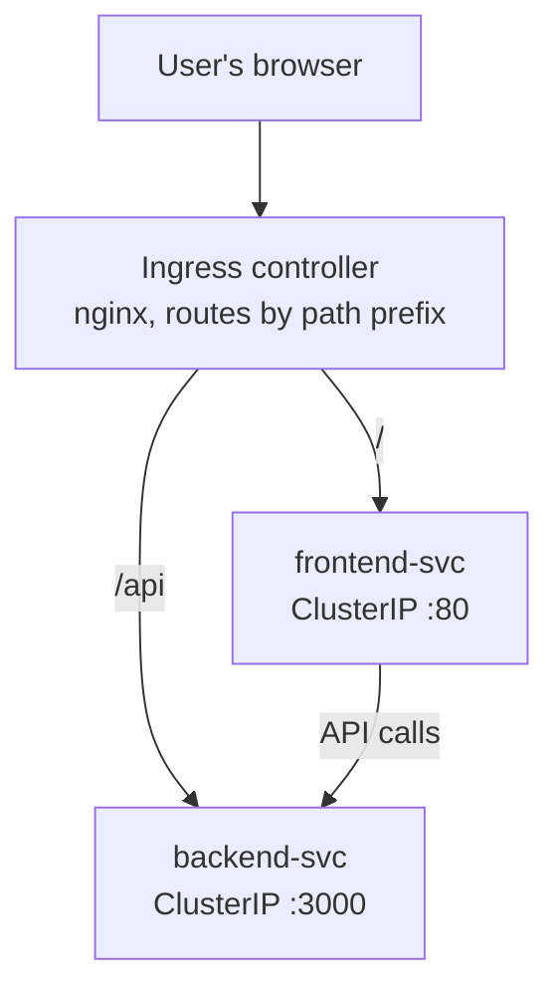
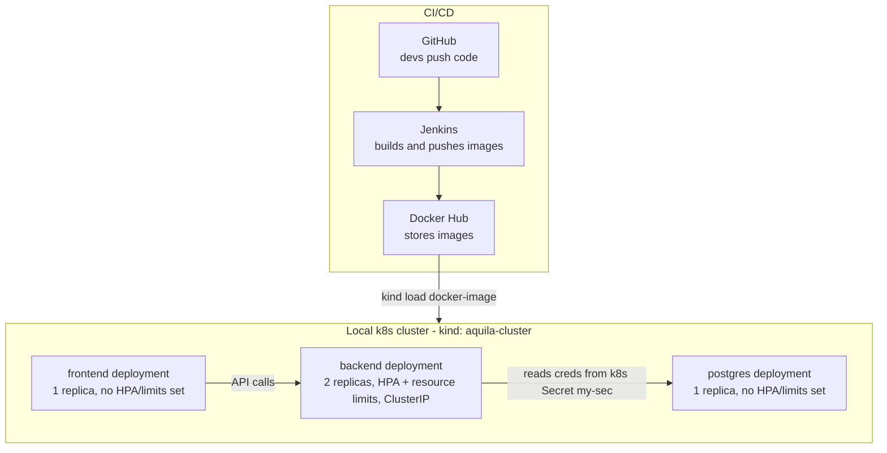

# School Management System — Local Kubernetes Deployment

An end-to-end deployment pipeline for a school management system, running on a local `kind` Kubernetes cluster with automated builds via Jenkins.

**Stack:** React/Node frontend + backend API, PostgreSQL database, Nginx Ingress, Jenkins CI/CD, Docker Hub image registry, `kind` (Kubernetes in Docker).

---

## Table of contents

- [Architecture](#architecture)
- [Repository structure](#repository-structure)
- [Kubernetes resources](#kubernetes-resources)
  - [Deployments](#deployments)
  - [Services](#services)
  - [Horizontal Pod Autoscaler](#horizontal-pod-autoscaler)
  - [Ingress](#ingress)
  - [Secrets](#secrets)
- [CI/CD pipeline](#cicd-pipeline)
- [Local setup](#local-setup)
- [Known gaps / follow-ups](#known-gaps--follow-ups)

---

## Architecture

### High-level traffic flow



### Low-level deployment flow



---

## Repository structure

```
.
├── backend/
│   ├── db/
│   │   ├── init.js
│   │   ├── pool.js
│   │   └── schema
│   ├── routes/
│   │   ├── classes.js
│   │   ├── enrollment.js
│   │   ├── students.js
│   │   └── teachers.js
│   ├── .dockerignore
│   ├── Dockerfile
│   ├── package.json
│   └── server.js
├── frontend/
│   ├── css/
│   │   └── style.css
│   ├── Dockerfile
│   ├── app.js
│   ├── index.html
│   └── style.css
├── k8-manifest/
│   ├── backend.yaml
│   ├── backend-svc.yaml
│   ├── frontend.yaml
│   └── frontend-svc.yaml
├── other files/
│   ├── DB-secret.yaml
│   ├── HPA.yaml
│   ├── db.yaml
│   ├── ingress.yaml
│   └── resource-limits.yaml
└── jenkinsfile
```

> **Automation note:** only the four manifests inside `k8-manifest/` (`backend.yaml`, `backend-svc.yaml`, `frontend.yaml`, `frontend-svc.yaml`) are applied by the Jenkins pipeline, and they're applied **every build**. Everything inside `other files/` — the Postgres Deployment, the Secret, the HPA, the Ingress, and the resource-limits file — is **not referenced anywhere in the Jenkinsfile**. These are one-time, manually-applied resources: whoever sets up a fresh cluster has to `kubectl apply` them by hand before the pipeline will produce a working app. This is worth calling out explicitly to contributors so nobody assumes the pipeline is fully self-contained.

---

## Kubernetes resources

### Deployments

| Deployment | File | Image | Replicas | Requests (CPU/Mem) | Limits (CPU/Mem) | Env vars | Applied by Jenkins? |
|---|---|---|---|---|---|---|---|
| `backend` | `k8-manifest/backend.yaml` | `kuunyangna/school-app-backend:v5` | 2 | 500m / 500Mi | 2 / 1000Mi | `DB_NAME`, `DB_USER`, `DB_PASSWORD` from Secret `my-sec`; `DB_HOST=postgres` (static) | ✅ every build |
| `frontend` | `k8-manifest/frontend.yaml` | `kuunyangna/school-app-frontend:v1` | 1 | *not set* | *not set* | none | ✅ every build |
| `postgres` | `other files/db.yaml` | `postgres` (no tag → `latest`) | 1 | *not set* | *not set* | `POSTGRES_DB`, `POSTGRES_USER`, `POSTGRES_PASSWORD` from Secret `my-sec` | ❌ manual, one-time only |

**Rollout strategy** (backend and frontend): `RollingUpdate`, `maxSurge: 25%`, `maxUnavailable: 25%`, `progressDeadlineSeconds: 600`.

> ⚠️ **`other files/resource-limits.yaml` is not a separate resource — it's an older copy of the backend Deployment without the `DB_*` env vars.** Since `k8-manifest/backend.yaml` already includes the same resource block *and* the env vars the backend needs to reach Postgres, applying `resource-limits.yaml` on its own would roll the backend back to a version without database credentials. Recommend deleting it, or repurposing it if it was meant to serve a distinct role.

> ⚠️ `postgres` and `frontend` currently have no resource `requests`/`limits`. On a shared local machine this means either pod can consume unbounded CPU/memory. Worth adding at least conservative limits before calling this "production-like."

### Services

| Service | File | Type | Port → Target port | Selector | Applied by Jenkins? |
|---|---|---|---|---|---|
| `backend-svc` | `k8-manifest/backend-svc.yaml` | ClusterIP | `3000` → `3000` (default, no `targetPort` set) | `app: backend` | ✅ every build |
| `frontend-svc` | `k8-manifest/frontend-svc.yaml` | ClusterIP | `80` → `80` | `app: frontend` | ✅ every build |
| `postgres` | `other files/postgres-svc.yaml`* | ClusterIP | `5432` → `5432` | `app: postgres` | ❌ manual, one-time only |

\* filename assumed — confirm the exact name you saved it under so this table stays accurate.

> ✅ **Resolved:** the `postgres` Service now exists (`app: postgres`, ClusterIP, port `5432` → `5432`), so `DB_HOST=postgres` in the backend Deployment resolves correctly via Kubernetes DNS.

### Horizontal Pod Autoscaler

| HPA | File | Target | Min replicas | Max replicas | Metrics | Applied by Jenkins? |
|---|---|---|---|---|---|---|
| `backend` | `other files/HPA.yaml` | `Deployment/backend` | 1 | 5 | CPU 80% avg utilization, Memory 80% avg utilization | ❌ manual, one-time only |

> Only the backend has an HPA configured. Frontend and Postgres scale manually (fixed at 1 replica each) — this is expected for a single-instance local database, but worth a deliberate call-out in the doc so it doesn't read as an oversight.

### Ingress

File: `other files/ingress.yaml` — ❌ manual, one-time only (not applied by Jenkins).

| Path | Path type | Backend service | Port |
|---|---|---|---|
| `/` | Prefix | `frontend-svc` | 80 |
| `/api` | Prefix | `backend-svc` | 3000 |

Ingress class: `nginx`. Requires an nginx ingress controller installed in the `kind` cluster (e.g. via the [kind-specific nginx ingress manifest](https://kind.sigs.k8s.io/docs/user/ingress/)).

### Secrets

The app depends on a Secret named **`my-sec`** with the following keys, consumed by both `backend` and `postgres` Deployments:

| Key | Used by |
|---|---|
| `POSTGRES_DB` | backend (`DB_NAME`), postgres |
| `POSTGRES_USER` | backend (`DB_USER`), postgres |
| `POSTGRES_PASSWORD` | backend (`DB_PASSWORD`), postgres |

File: `other files/DB-secret.yaml` — this **is** the `my-sec` Secret manifest referenced by both the `backend` and `postgres` Deployments above (via `secretKeyRef`). ❌ manual, one-time only (not applied by Jenkins).

Since this file holds the actual `POSTGRES_DB` / `POSTGRES_USER` / `POSTGRES_PASSWORD` values, it **should not be committed to Git** — add it to `.gitignore` and create it directly on the cluster instead:

```bash
kubectl create secret generic my-sec \
  --from-literal=POSTGRES_DB=schooldb \
  --from-literal=POSTGRES_USER=schooluser \
  --from-literal=POSTGRES_PASSWORD='replace-with-a-real-password'
```

Consider documenting this as a manual one-time setup step in your repo's contributing/setup guide, or moving to a sealed-secrets / external-secrets approach if this ever leaves "local dev."

---

## CI/CD pipeline

Defined in the root `Jenkinsfile`. Stages run in this order:

| Stage | What it does |
|---|---|
| 1. Checkout | Clones `main` branch from GitHub |
| 2. Build Backend Image | `docker build` in `backend/`, tags `:BUILD_NUMBER` and `:latest` |
| 3. Build Frontend Image | `docker build` in `frontend/`, tags `:BUILD_NUMBER` and `:latest` |
| 4. Push Images to Docker Hub | Logs in with stored credentials (`docker-creds`), pushes both tags for both images, logs out |
| 5. Load Images into kind | `kind load docker-image` for both images into the `aquila-cluster` node |
| 6. Phase 1: Deploy Backend | Applies `backend.yaml` + `backend-svc.yaml`, updates the image on the live Deployment, waits for rollout (120s timeout) |
| 7. Phase 2: Deploy Frontend | Applies `frontend.yaml` + `frontend-svc.yaml`, updates the image on the live Deployment, waits for rollout (120s timeout) |

**Post-build actions:** logs success/failure message; always runs `docker logout` regardless of outcome.

**Environment variables set at pipeline level:**

| Variable | Value |
|---|---|
| `DOCKERHUB_USER` | `kuunyangna` |
| `BACKEND_IMAGE` | `kuunyangna/school-app-backend` |
| `FRONTEND_IMAGE` | `kuunyangna/school-app-frontend` |
| `IMAGE_TAG` | `${BUILD_NUMBER}` (Jenkins build number) |
| `KIND_CONTEXT` | `kind-aquila-cluster` |

> Note: Postgres, the Secret, the HPA, the Ingress, and `resource-limits.yaml` aren't applied anywhere in this pipeline — they're presumably applied manually once and left in place, since they don't change per build. Worth a one-line comment in the Jenkinsfile itself saying so, so a future contributor doesn't assume they're missing.

---

## Local setup

```bash
# 1. Create the kind cluster (if not already created)
kind create cluster --name aquila-cluster

# 2. Point kubectl at it
kubectl config use-context kind-aquila-cluster

# 3. Install an nginx ingress controller (kind-specific manifest)
kubectl apply -f https://raw.githubusercontent.com/kubernetes/ingress-nginx/main/deploy/static/provider/kind/deploy.yaml

# 4. Create the app secret (see Secrets section above)
kubectl create secret generic my-sec \
  --from-literal=POSTGRES_DB=schooldb \
  --from-literal=POSTGRES_USER=schooluser \
  --from-literal=POSTGRES_PASSWORD='replace-with-a-real-password'

# 5. Apply Postgres, its Service, the Ingress, and the HPA
kubectl apply -f "other files/db.yaml"
kubectl apply -f "other files/postgres-svc.yaml"
kubectl apply -f "other files/ingress.yaml"
kubectl apply -f "other files/HPA.yaml"

# 6. Trigger the Jenkins pipeline (or apply k8-manifest/ manually the first time)
kubectl apply -f k8-manifest/
```

---

## Screenshots

Add screenshots of the running system below — replace each placeholder path with the actual image once you've added it to the repo (e.g. under a `docs/images/` folder).

### Jenkins pipeline

<!--  -->

### Grafana dashboards

<!--  -->
<!--  -->

### Application interface

<!--  -->
<!--  -->

> To use these: create `docs/images/` in your repo, drop the PNGs in, then uncomment the lines above and point each path at the matching filename. GitHub renders them inline once merged.

---

## Known gaps / follow-ups

- [x] ~~Add a `postgres` ClusterIP Service~~ — confirmed to exist in `other files/`, added to docs above
- [ ] Confirm the exact filename you saved the Postgres Service manifest as (docs currently assume `postgres-svc.yaml`)
- [ ] Decide whether to delete `other files/resource-limits.yaml` (older duplicate of `backend.yaml`, missing env vars) or repurpose it — as-is it's redundant with `k8-manifest/backend.yaml` and slightly dangerous if ever applied on its own
- [ ] Add resource `requests`/`limits` directly to the `frontend` and `postgres` Deployment manifests (currently unset)
- [ ] Move `other files/DB-secret.yaml` out of Git and add it to `.gitignore` — it holds the actual `my-sec` credential values referenced by the `backend` and `postgres` Deployments
- [ ] Consider whether Postgres, its Service, the Secret, the HPA, and the Ingress should be folded into the Jenkins pipeline (with idempotent `kubectl apply`) so a fresh cluster doesn't need manual setup
- [ ] Consider adding an HPA for `frontend` if traffic patterns warrant it
- [ ] Add screenshots to `docs/images/` and wire them into the Screenshots section above
